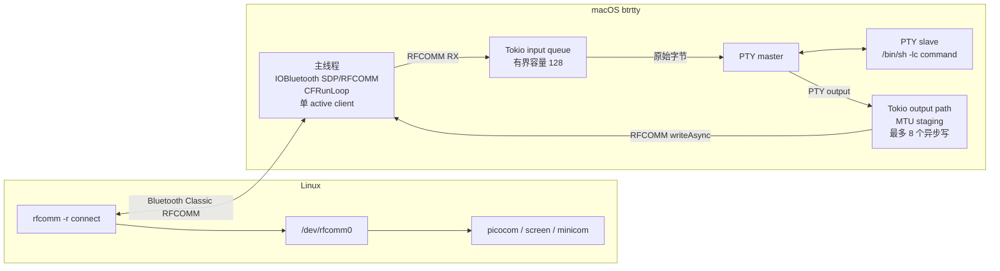

# btrtty

## 简介

`btrtty` 是一个 macOS 命令行程序，用 Bluetooth Classic RFCOMM 提供交互式 PTY。Linux 端通过 RFCOMM 串口连接后，可以使用 `picocom`、`screen` 或其他串口终端操作 Mac 上的 shell。

程序发布名为 `Btrtty Terminal` 的标准 Serial Port Profile（UUID `0x1101`）SDP service，RFCOMM channel 由 macOS 动态分配。每次只接受一个已配对的 Bluetooth 设备，并把 RFCOMM 与 PTY 之间的数据按原始字节转发。

## 架构



主线程独占 IOBluetooth 对象和 macOS run loop；Tokio 运行 PTY、shell child、输入泵和输出调度。RFCOMM 输入进入有界队列，队列满时关闭当前连接；PTY 输出按实际 MTU 分块，并由有限的异步写窗口提供反压。

## 编译/安装/使用方式

服务端必须在 macOS 上运行，并使用 Rust stable：

```bash
cargo build --release
cargo test --all-targets
cargo clippy --all-targets --all-features -- -D warnings
```

生成 ad-hoc signed 单文件：

```bash
./scripts/package.sh
```

产物为 `dist/btrtty`，不是 App Bundle。需要安装到 `PATH` 时：

```bash
sudo install -m 755 dist/btrtty /usr/local/bin/btrtty
```

先通过 macOS 和 Linux 的系统 Bluetooth 设置完成配对，然后在 Mac 启动：

```bash
btrtty
```

默认执行 `exec /bin/bash -l`，PTY 为 24 行、80 列。也可以指定 shell 命令和尺寸：

```bash
btrtty \
  --command 'exec /bin/bash -l' \
  --rows 24 \
  --cols 80
```

启动后记录实际输出的 Bluetooth address 和 RFCOMM channel：

```text
Registered Bluetooth Serial Port
Bluetooth address: AA:BB:CC:DD:EE:FF
SDP record handle: 0xXXXXXXXX
RFCOMM channel: 11
Waiting for paired client...
```

Linux 先确认存在 BlueZ 的 `rfcomm` 命令：

```bash
command -v rfcomm
```

连接并打开终端：

```bash
sudo rfcomm -r connect /dev/rfcomm0 MAC_BT_ADDRESS CHANNEL
picocom -b 115200 --flow n /dev/rfcomm0
```

`CHANNEL` 使用 Mac 启动日志中的实际值；`115200` 只是串口客户端参数，不是 Bluetooth 链路限速。退出时先关闭 `picocom`，再在运行 `rfcomm connect` 的终端按 Ctrl-C。

## 已知问题

- 仅实现 macOS 服务端；Linux 端依赖发行版提供的 BlueZ `rfcomm` 工具，部分发行版默认不安装该 deprecated 工具。
- 当前只检查远端设备是否已配对，没有 `--allow-device` 地址白名单，也不额外要求 RFCOMM 链路加密。
- 只允许一个 active client；第二个连接会被关闭。
- PTY 尺寸只在连接创建时设置，连接期间没有 resize 协议；`TERM` 固定为 `xterm-256color`，`COLORTERM` 固定为 `truecolor`。
- RFCOMM 输入队列溢出会关闭当前连接；PTY 输出使用有界缓冲，不保证在无线链路异常时保持连接。
- 自动化测试不替代真实 Mac/Linux Bluetooth 双机测试；实际连接、重连、终端兼容性仍需使用目标硬件验证。
